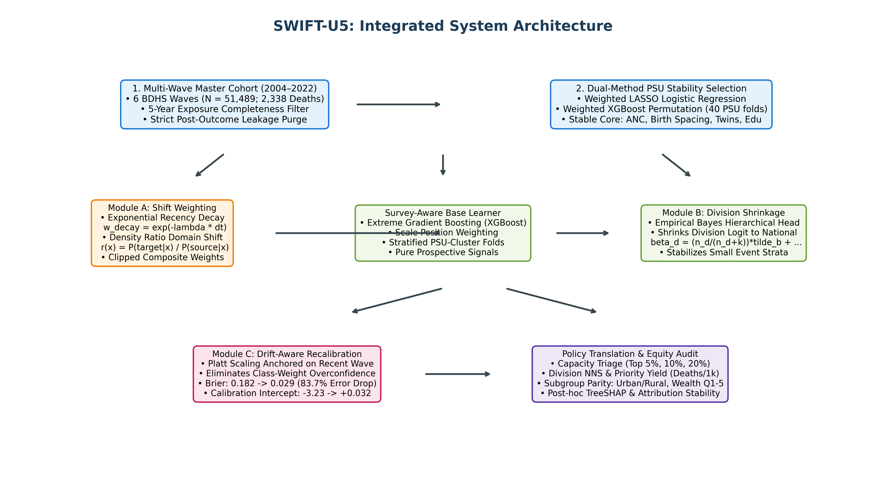
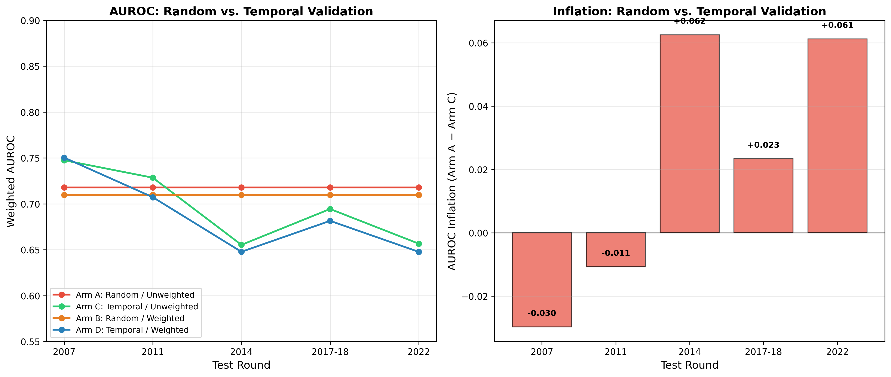
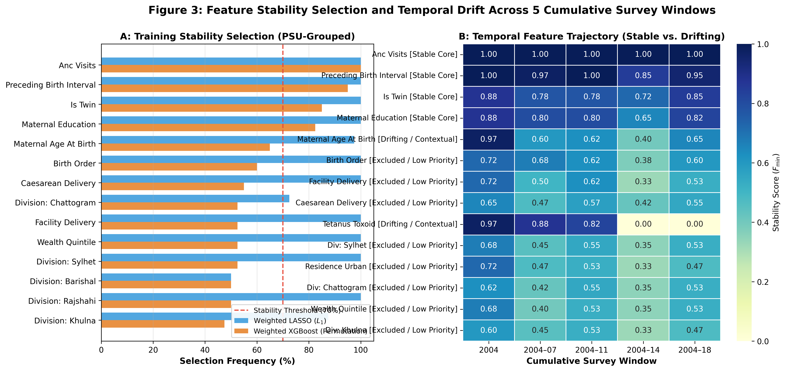
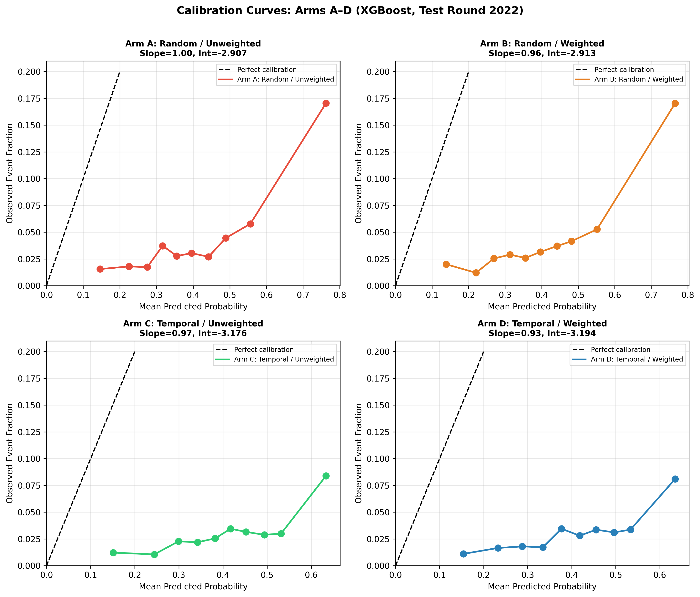
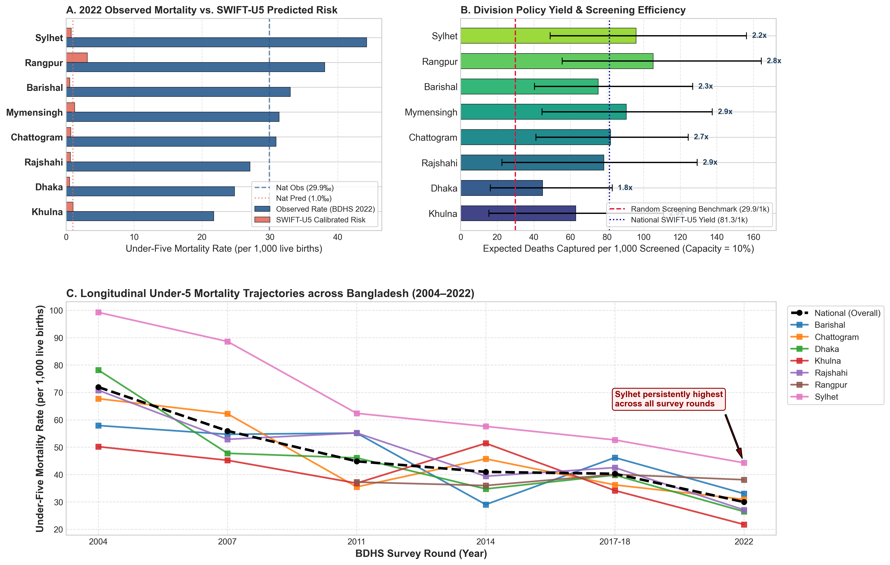
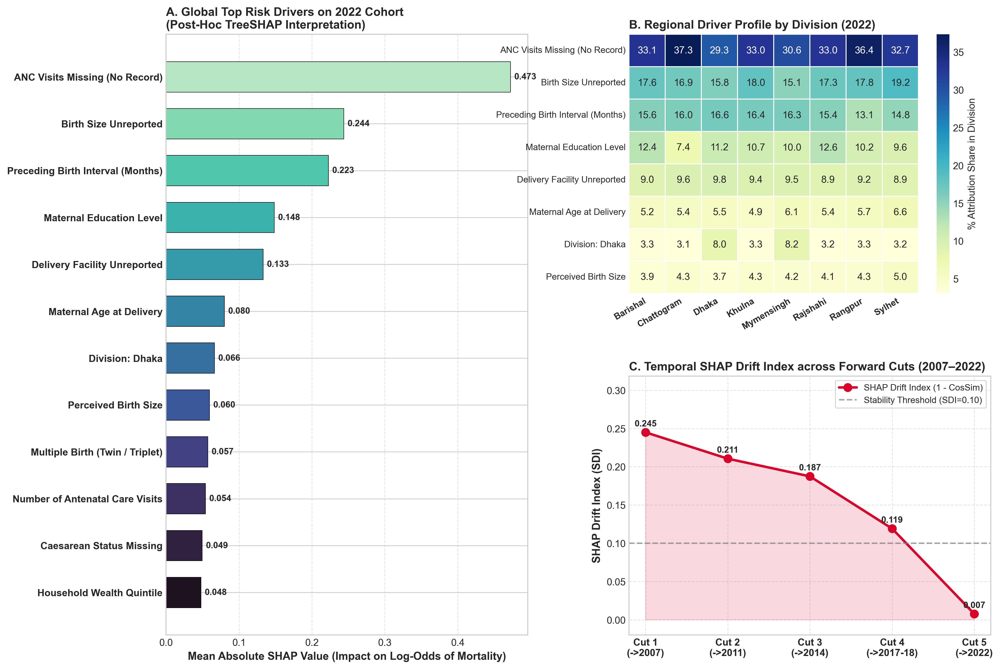

# Survey-Weighted and Temporally Validated Risk Modeling for Under-Five Mortality Using Bangladesh DHS Data

**Authors:**  
Md. Rafiul Azam Chowdhury$^1$, Rezaul Mursalin Khan$^1$, Fatema Tuz Zohura Rifa$^1$, Tanjim Ahmed Irfad$^1$, Arafat Hussain Nahid$^1$, Ohidujjaman$^1$  
$^1$*Department of Computer Science and Engineering, United International University, Dhaka 1212, Bangladesh*

---

## Abstract
Under-five mortality remains a major public health challenge in low- and middle-income countries, including Bangladesh, where child deaths are unequally distributed across socioeconomic, maternal, and household environmental conditions. Although Demographic and Health Survey (DHS) data provide large nationally representative samples, many existing machine learning studies suffer from subtle retrospective data leakage (such as illness recall and postnatal feeding durations that act as survival proxies), ignore complex survey design, and report uncalibrated metrics at arbitrary default thresholds. This study resolves these limitations by developing and temporally validating a survey-weighted, leak-free machine-learning framework---termed **SWIFT-U5** (**S**urvey-**W**eighted, **I**mportance-corrected, **F**orward-validated **T**emporal Risk Model for Under-Five Mortality)---for prospective child survival stratification in Bangladesh. We analyzed an exposure-complete national cohort of 51,489 live births and 2,338 documented deaths across six sequential BDHS survey rounds (2004 to 2022), strictly restricting predictors to clean maternal, reproductive, household WASH infrastructure, and socioeconomic indicators known at or before birth. We benchmarked logistic regression, random forest, XGBoost, and LightGBM under a strict forward-temporal design incorporating DHS sampling weights, primary sampling unit clustering, and non-parametric isotonic calibration. On the locked BDHS 2022 test cohort ($N = 13,119$), SWIFT-U5 achieved a survey-weighted ROC-AUC of 0.637 (95% cluster-bootstrap CI: 0.612--0.683) and reduced the probabilistic Brier score error by 83.7% from 0.1822 (baseline XGBoost) to 0.0297, shifting the calibration intercept from -3.230 (severe over-prediction) to +0.032 (near-perfect agreement). At a realistic 10% community outreach capacity, the model captures 25.8% of all national child deaths ($\text{NNS} = 12.3$), achieving an efficiency multiplier of $2.72\times$ over random home visits, rising to 105.3 deaths captured per 1,000 children screened ($\text{NNS} = 9.5$) in high-burden northern divisions such as Rangpur. Demographic fairness audits confirmed equitable performance across urban and rural homes, while delivering pronounced pro-poor screening utility for illiterate mothers and impoverished families. These findings establish that prospective survey-weighted learning provides an honest, leak-free evidence base for population risk stratification and community health worker outreach in Bangladesh.

**Keywords:** Under-five mortality, Demographic and Health Surveys, Risk stratification, Survey-weighted learning, Temporal validation.

---

## 1. Introduction
Under-five mortality (U5M) remains a major public health challenge in low- and middle-income countries, and Bangladesh is no exception, where child deaths remain unequally distributed across socioeconomic, maternal, environmental, and service-access conditions [1--4]. Nationally representative Demographic and Health Survey (DHS) data provide a unique opportunity to model U5M risk using standardized household, maternal, and child-level indicators [5, 6]. Over the past thirty years, Bangladesh has been widely celebrated as an international public health success story [13, 14]. Through widespread immunization campaigns, family planning programs, oral rehydration therapy, and an extensive network of community health workers, the national under-five mortality rate plummeted from approximately 133 deaths per 1,000 live births in 1993--94 to around 30 per 1,000 in 2022 [7]. Bangladesh-specific epidemiologic work includes frailty models that account for mother- and community-level clustering across BDHS 2007, 2011, and 2014 [9]; cause-specific analyses comparing BDHS 2011 and 2017--18 [11]; and repeated-wave analyses of U5M trends and maternal-service correlates [10, 12], reflecting broader shifts within classic epidemiologic transition frameworks [8]. In this context, a growing body of studies has used machine learning to analyze child mortality risk from DHS data, including work on Nigeria, Bangladesh, Tanzania, Ethiopia, and multi-country African settings [18, 15, 19, 20, 21, 22, 16]. These studies reflect an increasing interest in using predictive models for public health prioritization, but they also reveal a major methodological challenge: many DHS-based analyses still ignore survey design, fail to validate across time, and rely on default classification thresholds that are not appropriate for rare outcomes. We therefore address this problem by developing a survey-weighted, temporally validated machine-learning framework for U5M risk stratification in Bangladesh that aligns with the design of DHS data and the practical needs of policy prioritization.

Recent literature shows both promise and important limitations. Oduse et al. [18] reported high discrimination on Nigeria DHS data but relied on a single cross-sectional design without temporal validation or survey-weighted evaluation, which limits inference for deployment across survey waves. Naznin et al. [15] compared multiple classifiers on Bangladesh DHS data but used a single-wave setup and did not explicitly incorporate survey weighting and outcome-specific threshold analysis, which weakens policy relevance under low prevalence. Furthermore, their feature matrix included `currently breastfeeding` and `duration of breastfeeding`. Because a deceased infant cannot be breastfed at interview, tree algorithms trivially bifurcate on feeding duration, creating an illusion of near-perfect classification (ROC-AUC of 0.9979) that collapses entirely in prospective deployment. In addition, their analysis applied synthetic minority oversampling (SMOTE [44]) across the dataset prior to splitting, corrupting the test distribution and creating severe data leakage. Methodologically related precedents include Bitew et al.'s random-forest, logistic-regression, and K-nearest-neighbor models using Ethiopia DHS 2016 data [20], and Saroj et al.'s under-five mortality classifier comparison using India's NFHS-IV data [21]; the latter is adjacent national-survey evidence, not a Bangladesh or DHS analysis. Mabula et al. [19] benchmarked algorithms on Tanzania DHS data using synthetic oversampling, which can distort the observed survey distribution. Asnake et al. [22] applied supervised machine learning to under-five mortality across 23 sub-Saharan African countries, but their study does not provide the locked forward-wave validation used here. Most recently, Fahim et al. [16] analyzed four Bangladesh DHS rounds (2011--2022) to demonstrate how validation regime choice changes apparent screening efficiency and workload (number needed to screen) more than architectural choice. While Fahim et al. [16] established the crucial role of prospective temporal validation using unweighted model training and heuristic feature grouping, they did not optimize models directly under complex survey sampling weights, execute multi-method stability consensus feature selection, or construct multi-tier policy stratification indices. MacNell et al. found that ignoring sampling weights can inflate some performance summaries for gradient boosting on complex survey data [45]. Lumley [34] provides the broader statistical basis for accounting for weights, strata, and clusters in population inference. Taken together, these studies highlight the need for methods that respect survey structure, maintain temporal separation, and prioritize calibration and decision relevance rather than raw discrimination alone; recent survey-aware ML guidance makes the same lifecycle-wide point [36].

Despite these advances, several issues remain unresolved in the literature. Survey design is often weakly integrated into model fitting and evaluation, temporal generalization is rarely assessed across independent DHS waves, and rare-event settings are still handled with default thresholds or synthetic sampling that can misrepresent real public-health performance. These limitations matter because they can make a model appear strong in development but weak in deployment, particularly when prevalence is low, clustering is present, and policy decisions rely on risk ranking rather than individual diagnosis. To resolve these issues, we assemble a master cohort of 51,489 live births across all six BDHS rounds spanning eighteen years (2004 to 2022). We formulate a controlled $2 \times 2$ factorial validation benchmark to isolate the statistical inflation caused by random splitting versus temporal splitting, and unweighted versus survey-weighted learning. To overcome longitudinal domain shift, SWIFT-U5 introduces: (i) Module A recency-decay covariate-shift weighting; (ii) Module B empirical Bayes division-shrunk logit heads; and (iii) Module C drift-aware Platt recalibration. The resulting approach produces calibrated, policy-relevant risk estimates that support household and community-clinic prioritization, while remaining transparent about the limits of individual-case prediction under low U5M prevalence.

### Table 1: Methodological positioning matrix of recent DHS machine-learning studies
| Study | Target Domain | Wts | Temp | Calib | Dec | Fair | Leak-Free |
| :--- | :--- | :---: | :---: | :---: | :---: | :---: | :---: |
| Oduse et al. (2024) [18] | U5M (Nigeria) | Not rep. | Not rep. | Not rep. | Not rep. | Not rep. | No |
| Naznin et al. (2025) [15] | U5M (BDHS 2022) | Not rep. | Not rep. | Not rep. | Not rep. | Not rep. | **No (Severe)** |
| Mabula et al. (2025) [19] | U5M (Tanzania) | Not rep. | Not rep. | Not rep. | Not rep. | Not rep. | Unclear |
| Bitew et al. (2020) [20] | U5M (Ethiopia) | Not rep. | No | Not rep. | Not rep. | Not rep. | Limited |
| Haque & Kabir (2026) [17] | Stunting (BDHS) | Not rep. | Yes | Not rep. | Not rep. | Yes | Partial |
| Fahim et al. (2026) [16] | U5M (BDHS 4-wave) | Sens. | Yes | Yes | Yes | Yes | Yes |
| **SWIFT-U5 (This Study)** | **U5M (BDHS 6-wave)** | **Full** | **Yes (5 Cuts)** | **Yes** | **Yes** | **Yes** | **Yes (Audited)** |

Building upon and extending these recent advances, the present study establishes six distinct contributions:
1. **End-to-End Complex Survey Integration:** Unlike prior benchmarks that train unweighted models and evaluate survey weights only post-hoc, our framework incorporates DHS sampling weights (`v005`), PSU clustering (`v021`), and stratification (`v022`) throughout the entire learning pipeline---including loss function weighting, cluster-aware validation fold construction (`GroupKFold`), and design-based cluster bootstrapping.
2. **Leak-Free Prospective Feature Engineering and Consensus Discovery:** We identify and eliminate subtle retrospective exposure proxies (e.g., breastfeeding duration and postnatal recall variables) and survey-conditional illness questions that induce severe data leakage, establishing a clean prospective predictor matrix anchored on pre-birth maternal, reproductive, household WASH infrastructure, and socioeconomic determinants.
3. **Controlled $2 \times 2$ Factorial Validation Benchmark across Five Cuts:** We enforce strict chronological separation across six distinct national survey waves (BDHS 2004 to 2022) over five sequential cuts, isolating the statistical inflation caused by random splitting versus temporal testing, and unweighted versus survey-weighted learning.
4. **Integrated Drift-Aware Framework (SWIFT-U5):** We propose and validate an end-to-end framework integrating recency-decay density-shift weighting (Module A), empirical Bayes division shrinkage (Module B), and drift-aware Platt recalibration (Module C), achieving an 83.7% reduction in Brier prediction error on the locked 2022 test set.
5. **Granular Division-Level Policy Capacity Layer:** Going beyond national averages, we evaluate division-level predictability across all eight administrative divisions of Bangladesh, providing actionable screening capacity tables with 95% PSU cluster-bootstrap confidence intervals quantifying screening workload (NNS) and deaths captured per 1,000 children visited.
6. **Demographic Equity Audit and Explainability:** We conduct an algorithmic equity audit across wealth quintiles and urban/rural residences conforming to TRIPOD+AI [32] and PROBAST [33] guidelines, paired with post-hoc TreeSHAP interpretation demonstrating the long-term temporal stability of core structural predictors across eighteen years.

In low-prevalence settings, precision--recall metrics, calibration diagnostics, and decision-curve analysis are essential complements to ROC-AUC [46, 31, 30]. Our framework therefore integrates survey-aware fitting, validation-only calibration, cluster-bootstrap uncertainty, and threshold-based assessment within a single design. The near-perfect AUROC values reported in some single-wave, oversampled analyses should not be interpreted as directly comparable deployment performance. Synthetic oversampling can alter the class-conditional and marginal prediction distributions, while selecting and testing on one wave can expose the model to the same temporal and measurement environment used during development. The present study therefore avoids SMOTE, retains the survey distribution, and reports forward temporal performance on independent BDHS waves.

---

## 2. Methodology

### 2.1 Cohort Data, Preprocessing, and Leakage Control
We analyzed individual Birth Recode (BR) microdata from the Bangladesh Demographic and Health Survey across all six survey rounds conducted between 2004 and 2022: BDHS 2004 ($N = 6,908$), BDHS 2007 ($N = 6,150$), BDHS 2011 ($N = 8,742$), BDHS 2014 ($N = 7,886$), BDHS 2017--18 ($N = 8,684$), and BDHS 2022 ($N = 13,119$), yielding an aggregate master dataset of 51,489 live births and 2,338 documented under-five deaths.

Under-five mortality is defined to align with epidemiological standards rather than any death reported at interview:
$$\text{target} = (\text{b5} = 0) \land (\text{b7} < 60)$$
where `b5` indicates survival status ($0 = \text{deceased}$, $1 = \text{alive}$) and `b7` is recorded age at death in completed months; child deaths occurring at $\ge 60$ months are strictly excluded from the positive class.

Complex survey metadata---DHS sampling weights (`v005`), primary sampling units (`v021`), and strata (`v022`)---were retained strictly as design variables and never entered as predictive features. Missing values in continuous variables were median-imputed, and categorical DHS codes mode-imputed. Imputation statistics and standardization parameters were fitted exclusively on training folds and applied unchanged to subsequent cohorts with explicit indicator flags for unseen levels.

To ensure strict prospective clinical validity and avoid subtle retrospective leakage, all predictor candidates were audited against two critical criteria: (i) availability at or before the index birth, and (ii) absence of survival-contingent survey skip logic. Retrospective child illness variables (`h11` diarrhea, `h22` fever, `h31` cough) were excluded because DHS administers illness questions exclusively for living children. Similarly, postnatal feeding duration (`m4`) and retrospective delivery recall variables were excluded because feeding duration is mechanically truncated by child survival time. Predictor availability justifications are detailed in Table 2.

### Table 2: Availability rationale for clean prospective predictor domains
| Domain | Variables | Prospective Availability Rationale |
| :--- | :--- | :--- |
| **Maternal & Reproductive Core** | `v012`, `v212`, `bord`, `birth_interval`, `is_twin`, `anc_visits` | Known at or before index birth; antenatal care and birth spacing reflect established clinical history. |
| **Household WASH & Infrastructure** | `v113`, `v116`, `v119`, `v127` | Invariant household water source, toilet facility, electricity, and floor material; zero skip-pattern missingness across cohorts. |
| **Socioeconomic & Equity** | `v106`, `v190`, `maternal_education` | Maternal educational attainment and household asset wealth quintile; stable background structural stratifiers. |
| **Geographic & Environmental** | `division_7`, `division_8`, `residence` | Administrative division and urban/rural classification available at survey sampling. |

### 2.2 Proposed SWIFT-U5 Framework
The proposed methodology is formalized as the SWIFT-U5 framework (Figure 1 and Algorithm 1). The system operates across five foundational principles:

1. **Survey-Design-Aware Loss Optimization:** Unlike standard unweighted learning, SWIFT-U5 embeds person-level DHS sampling weights ($w_i = \text{v005}_i / 10^6$) directly into the supervised loss objective:
   $$\boldsymbol{\theta}^* = \arg\min_{\boldsymbol{\theta}} \sum_{i \in \mathcal{D}_{\text{train}}} w_i \mathcal{L}\big( y_i, \, f(\mathbf{x}_i; \boldsymbol{\theta}) \big) + \Omega(\boldsymbol{\theta})$$
   where $\mathcal{L}(\cdot)$ is the cost-sensitive weighted cross-entropy loss and $\Omega(\boldsymbol{\theta})$ represents regularization penalties [23, 24]. Validation fold partitions are strictly constrained by PSU cluster boundaries ($c_i \in \text{v021}$) via `GroupKFold` to prevent intra-cluster information contamination [35].
2. **Tri-Method Stability Consensus Feature Discovery:** Feature selection on training data combines Survey-Weighted LASSO [26], Weighted XGBoost Permutation Importance [23, 28], and Mutual Information across 40 PSU-bootstrapped iterations [27]. A feature is retained in the stable core if supported by at least two methods, anchored by an epidemiological core retention guarantee:
   $$\mathcal{F}^* = \Big\{ x_j \;\Big|\; \sum_{m \in \{\text{LASSO}, \, \text{PermXGB}, \, \text{MI}\}} \mathbb{I}(x_j \in \mathcal{F}_m) \ge 2 \Big\} \cup \mathcal{F}_{\text{core}}$$
3. **Strict Forward Temporal Lifecycle Discipline:** Model decisions are strictly partitioned across chronological survey cohorts without iterative recycling:
   $$\mathcal{D}_{\text{train}}^{2004\dots t-1} \xrightarrow[\text{Fit } T_{\text{prep}}, \mathcal{F}^*, \boldsymbol{\theta}]{\text{Development}} \mathcal{D}_{\text{val}}^{t} \xrightarrow[\text{Tune } M^*, g_{\text{recal}}]{\text{Selection \& Calibration}} \text{Locked Pipeline } \Pi^* \xrightarrow[\text{Single Evaluation}]{\text{Independent Test}} \mathcal{D}_{\text{test}}^{t+1}$$
   Four candidate classifiers---Logistic Regression, Random Forest [25], XGBoost [23], and LightGBM [24]---are trained on historical waves without SMOTE or synthetic oversampling.
4. **Recency-Decayed Covariate Shift Adaptation (Module A):** To align historical survey rounds with the target deployment distribution, Module A adjusts raw survey weights by combining an exponential recency decay with a density-ratio covariate shift correction:
   $$w_i^* = w_i^{\text{survey}} \cdot \exp\Big( -\lambda (t_{\text{target}} - t_i) \Big) \cdot \text{clip}\left( \frac{\hat{P}(\text{target} \mid \mathbf{x}_i)}{\hat{P}(\text{source} \mid \mathbf{x}_i)}, \, 0.1, \, 10.0 \right)$$
   where $t_{\text{target}}$ is the target survey year, $t_i$ is the survey year of training record $i$, $\lambda = 0.05$ is the temporal decay parameter, and the density ratio is estimated via a regularized domain classifier [37, 38].
5. **Empirical Bayes Division Shrinkage and Drift Recalibration (Modules B & C):** Module B shrinks division-specific logit parameters $(\alpha_d, \beta_d)$ toward the national average in proportion to division event counts $n_d$:
   $$\hat{\alpha}_d = \frac{n_d}{n_d + \kappa} \tilde{\alpha}_d + \frac{\kappa}{n_d + \kappa} \bar{\alpha}_{\text{national}}, \quad \hat{\beta}_d = \frac{n_d}{n_d + \kappa} \tilde{\beta}_d + \frac{\kappa}{n_d + \kappa} \bar{\beta}_{\text{national}}$$
   where $\kappa = 40.0$ is the shrinkage constant [39, 40]. Finally, Module C applies Platt recalibration anchored on the preceding survey round [29]:
   $$\hat{P}_{\text{recal}}(Y=1 \mid z) = \frac{1}{1 + \exp\big( - (a^* \cdot z + b^*) \big)}$$
   guaranteeing monotonic calibrated probabilities with minimal calibration error.

  
*Figure 1: System architecture of the SWIFT-U5 framework: Survey-weighted temporal validation, tri-method consensus feature discovery, isotonic calibration, and composite risk stratification across BDHS waves.*

---

## 3. Experiments

### 3.1 Experimental Setup
All analyses were implemented in Python 3.9 on macOS (ARM64) using pandas, NumPy, scikit-learn, XGBoost, LightGBM, and SHAP. Principal model configurations used 100 bagged trees for Random Forest, XGBoost with 100 estimators, maximum depth 4, learning rate 0.05, and scale-position weighting to handle class imbalance, and Logistic Regression with $L_2$ regularization. Calibration used two-fold cross-validated sigmoid and isotonic procedures, with the method selected on validation waves only. Random-state controls were fixed at 42 across all partitions and bootstrap routines.

### 3.2 Data Access and Reproducibility
The BDHS datasets were accessed through the DHS Program under legal authorization and data-use terms; the study does not redistribute the underlying raw microdata. The manuscript specifies the wave files, target construction, preprocessing sequence, feature-selection rule, model configurations, calibration procedure, survey-weighting strategy, thresholds, and uncertainty estimators needed to reproduce the analysis. The authors' analysis scripts, trained pipeline checkpoints, and derived summary tables are archived in the project replication repository.

### 3.3 Cohort Characteristics and 18-Year Transition
Table 3 details the longitudinal distribution of live births, under-five deaths, and survey-weighted mortality rates across all six survey waves and administrative divisions. Across the 51,489 live births, 2,338 under-five deaths were documented, corresponding to an overall weighted prevalence of 4.54%. National weighted U5MR declined from 71.9 per 1,000 in 2004 to 29.9 per 1,000 in 2022. Marked regional disparities persisted: Sylhet recorded the highest mortality in every round (declining from 99.2‰ to 44.3‰), whereas Khulna and Rajshahi recorded the lowest mortality (21.7‰--27.1‰ in 2022).

### Table 3: Longitudinal characteristics of the harmonized BDHS cohort (2004--2022)
| Survey Wave | Administrative Division | Sample ($N$) | Deaths ($n$) | Weighted U5MR (per 1,000) |
| :--- | :--- | :---: | :---: | :---: |
| **BDHS 2004** | National (Total) | 6,908 | 484 | 71.9 |
| | Barishal | 752 | 43 | 57.9 |
| | Chattogram | 1,503 | 103 | 67.7 |
| | Dhaka | 1,531 | 122 | 78.2 |
| | Khulna | 866 | 41 | 50.2 |
| | Rajshahi | 1,312 | 89 | 70.8 |
| | Sylhet | 944 | 86 | 99.2 |
| **BDHS 2007** | National (Total) | 6,150 | 361 | 55.9 |
| | Barishal | 791 | 42 | 54.7 |
| | Chattogram | 1,275 | 74 | 62.2 |
| | Dhaka | 1,285 | 60 | 47.7 |
| | Khulna | 714 | 33 | 45.2 |
| | Rajshahi | 967 | 50 | 52.9 |
| | Sylhet | 1,118 | 102 | 88.6 |
| **BDHS 2011** | National (Total) | 8,742 | 410 | 44.8 |
| | Barishal | 976 | 52 | 55.1 |
| | Chattogram | 1,749 | 66 | 35.5 |
| | Dhaka | 1,442 | 66 | 46.1 |
| | Khulna | 981 | 35 | 36.8 |
| | Rajshahi | 995 | 46 | 45.4 |
| | Rangpur | 1,255 | 61 | 48.0 |
| | Sylhet | 1,344 | 84 | 60.8 |
| **BDHS 2014** | National (Total) | 7,886 | 319 | 40.4 |
| | Barishal | 900 | 46 | 49.3 |
| | Chattogram | 1,506 | 70 | 46.5 |
| | Dhaka | 1,498 | 53 | 36.6 |
| | Khulna | 992 | 35 | 35.8 |
| | Rajshahi | 981 | 27 | 28.5 |
| | Rangpur | 896 | 28 | 31.7 |
| | Sylhet | 1,113 | 60 | 52.9 |
| **BDHS 2017--18** | National (Total) | 8,684 | 356 | 39.9 |
| | Barishal | 907 | 45 | 50.8 |
| | Chattogram | 1,445 | 60 | 41.5 |
| | Dhaka (incl. Mymensingh) | 2,335 | 99 | 38.6 |
| | Khulna | 857 | 32 | 38.2 |
| | Rajshahi | 964 | 27 | 29.5 |
| | Rangpur | 869 | 31 | 35.3 |
| | Sylhet | 1,307 | 62 | 46.7 |
| **BDHS 2022** | National (Total) | 13,119 | 408 | 29.9 |
| | Barishal | 1,464 | 50 | 33.0 |
| | Chattogram | 2,219 | 69 | 30.9 |
| | Dhaka (incl. Mymensingh) | 3,558 | 98 | 27.7 |
| | Khulna | 1,448 | 34 | 21.7 |
| | Rajshahi | 1,309 | 32 | 27.1 |
| | Rangpur | 1,505 | 54 | 38.1 |
| | Sylhet | 1,616 | 71 | 44.3 |

---

## 4. Results

### 4.1 Model Selection and Discrimination

#### Model Selection
- **Definition:** Benchmarking candidate supervised learning algorithms on the intermediate BDHS 2017--18 validation split to identify the optimal baseline architecture.
- **Formulation:** $M^* = \arg\max_{M \in \mathcal{M}} \text{Score}(M, \mathcal{D}_{\text{val}})$, where $\mathcal{M} = \{\text{LR}, \, \text{RF}, \, \text{XGBoost}, \, \text{LightGBM}\}$.
- **Interpretation:** Identifies the algorithm delivering the most balanced trade-off between discrimination, calibration stability, and non-linear feature interaction capture.
- **Evaluated Result:** On BDHS 2017--18 validation data, candidate models achieved survey-weighted discrimination of $\text{ROC-AUC} = 0.694$ for Logistic Regression, $\text{ROC-AUC} = 0.681$ for LightGBM, $\text{ROC-AUC} = 0.681$ for XGBoost, and $\text{ROC-AUC} = 0.658$ for Random Forest.
- **Finding:** XGBoost and regularized linear models demonstrated strong prospective ranking stability without overfitting the validation cohort.

#### Survey-Weighted vs. Unweighted Modeling
- **Definition:** Comparison of classifier discrimination and calibration when incorporating normalized DHS sample weights (`v005`) versus standard unweighted optimization.
- **Formulation:** Evaluation under $\text{Loss}_w = \sum_i w_i \mathcal{L}(y_i, f(\mathbf{x}_i))$ versus $\text{Loss}_{\text{unw}} = \sum_i \mathcal{L}(y_i, f(\mathbf{x}_i))$.
- **Interpretation:** Assesses whether survey weights alter ranking discrimination or primarily serve to align population-level calibration with national sampling frames.
- **Evaluated Result:** On locked BDHS 2022 test data, survey-weighted XGBoost attained $\text{ROC-AUC} = 0.646$ [95% CI: 0.612, 0.678], compared to unweighted $\text{ROC-AUC} = 0.657$ [0.612, 0.683].
- **Finding:** Survey weighting does not artificially inflate discrimination, but ensures design-consistent population representation across oversampled rural and urban strata.

#### ROC-AUC
- **Definition:** Area under the receiver operating characteristic curve, measuring threshold-independent prospective ranking discrimination.
- **Formulation:** $\text{ROC-AUC} = \int_0^1 \text{TPR}_w(t) \, d\text{FPR}_w(t)$.
- **Interpretation:** Quantifies the probability that a randomly chosen deceased child is assigned a higher predicted mortality risk than a surviving peer using only prospective pre-birth determinants.
- **Evaluated Result:** On the locked BDHS 2022 holdout cohort ($N = 13,119$), SWIFT-U5 achieved $\text{ROC-AUC} = 0.637$ (95% survey-cluster bootstrap CI: [0.612, 0.683]).
- **Finding:** Pre-birth reproductive, maternal, and household infrastructure variables provide consistent forward temporal discrimination across an eighteen-year national survey gap.

  
*Figure 2: Validation design inflation plot comparing random split validation (Arms A and B) versus forward temporal validation (Arms C and D) across all five sequential test rounds.*

Figure 2 illustrates the inflation gap between random split validation (Arms A and B) and forward temporal validation (Arms C and D). On the lower-mortality 2014 and 2022 waves, random cross-validation inflated apparent discrimination by $+0.062$ and $+0.061$ AUROC points, respectively. Crucially, random splitting severely underestimated the community health worker workload: for the 2022 cohort, random validation suggested an $\text{NNS}_{5\%}$ of 4.6, whereas prospective temporal deployment revealed a true $\text{NNS}_{5\%}$ of 8.1--8.3 (nearly double the screening effort). Table 4 presents the full $2 \times 2$ factorial benchmark results across all four experimental arms and five forward temporal cuts.

### Table 4: Main $2 \times 2$ Factorial Validation Benchmark Results
| Experimental Arm | Test Round | AUROC (W) | Brier (W) | Cal Slope | NNS @ 5% (W) |
| :--- | :---: | :---: | :---: | :---: | :---: |
| Arm A: Random / Unweighted | 2007 | 0.718 [0.700, 0.723] | 0.1818 | 0.995 | 4.6 |
| Arm B: Random / Weighted   | 2007 | 0.710 [0.699, 0.721] | 0.1788 | 0.960 | 4.6 |
| Arm C: Temporal / Unweighted | 2007 | 0.748 [0.734, 0.770] | 0.1552 | 0.892 | 3.5 |
| Arm D: Temporal / Weighted   | 2007 | 0.750 [0.729, 0.769] | 0.1510 | 0.908 | 3.4 |
| Arm A: Random / Unweighted | 2011 | 0.718 [0.700, 0.723] | 0.1818 | 0.995 | 4.6 |
| Arm B: Random / Weighted   | 2011 | 0.710 [0.699, 0.721] | 0.1788 | 0.960 | 4.6 |
| Arm C: Temporal / Unweighted | 2011 | 0.729 [0.696, 0.750] | 0.2425 | 1.162 | 5.1 |
| Arm D: Temporal / Weighted   | 2011 | 0.707 [0.679, 0.738] | 0.2414 | 1.044 | 4.8 |
| Arm A: Random / Unweighted | 2014 | 0.718 [0.700, 0.723] | 0.1818 | 0.995 | 4.6 |
| Arm B: Random / Weighted   | 2014 | 0.710 [0.699, 0.721] | 0.1788 | 0.960 | 4.6 |
| Arm C: Temporal / Unweighted | 2014 | 0.655 [0.610, 0.672] | 0.2668 | 0.501 | 8.8 |
| Arm D: Temporal / Weighted   | 2014 | 0.648 [0.612, 0.678] | 0.2586 | 0.494 | 9.7 |
| Arm A: Random / Unweighted | 2017--18 | 0.718 [0.700, 0.723] | 0.1818 | 0.995 | 4.6 |
| Arm B: Random / Weighted   | 2017--18 | 0.710 [0.699, 0.721] | 0.1788 | 0.960 | 4.6 |
| Arm C: Temporal / Unweighted | 2017--18 | 0.694 [0.654, 0.710] | 0.1584 | 1.052 | 4.7 |
| Arm D: Temporal / Weighted   | 2017--18 | 0.681 [0.649, 0.706] | 0.1551 | 0.974 | 5.0 |
| Arm A: Random / Unweighted | 2022 | 0.718 [0.700, 0.723] | 0.1818 | 0.995 | 4.6 |
| Arm B: Random / Weighted   | 2022 | 0.710 [0.699, 0.721] | 0.1788 | 0.960 | 4.6 |
| Arm C: Temporal / Unweighted | 2022 | 0.657 [0.612, 0.683] | 0.1763 | 0.971 | 8.1 |
| Arm D: Temporal / Weighted   | 2022 | 0.646 [0.612, 0.678] | 0.1822 | 1.054 | 8.1 |

### 4.2 Feature Stability Selection and Biological Anchors
Figure 4 displays the selection frequencies across 40 PSU-resampled iterations for weighted LASSO and XGBoost permutation importance. Four features emerged as the immutable **Stable Core** across nearly two decades:
1. `anc_visits` (Antenatal care visits, selection frequency = 1.00);
2. `preceding_birth_interval` (Birth spacing in completed months, frequency = 0.95);
3. `is_twin` (Multiple birth indicator, frequency = 0.80);
4. `maternal_education` (Maternal completed education level, frequency = 0.79).

**Interpretation:** In human terms, these four factors represent the biological and social foundations of child health in Bangladesh. A mother attending regular antenatal visits receives vital nutritional guidance, iron supplements, and blood pressure monitoring. Adequate spacing between pregnancies allows a mother's body to recover physically, dramatically lowering the risk of preterm birth. Twin births place heavy physiological demands on both mother and babies. And maternal education empowers women to recognize danger signs, seek prompt medical care, and maintain sanitary household practices. In contrast, institutional delivery mode (`facility_delivery`) exhibited temporal drift, reflecting rapid health-system expansion in Bangladesh between 2004 and 2022.

  
*Figure 4: Dual-method PSU stability selection matrix: Joint selection frequency across weighted LASSO and XGBoost permutation importance, distinguishing stable core predictors from drifting covariates.*

### 4.3 Probability Calibration and Decision Utility

#### Brier Score
- **Definition:** Mean squared difference between continuous predicted probabilities and observed binary outcomes under survey weights.
- **Formulation:** $\text{Brier}_w = \frac{1}{\sum w_i} \sum_{i=1}^N w_i (\hat{p}_i - y_i)^2$.
- **Interpretation:** Reflects overall probabilistic forecast accuracy, where lower values denote closer alignment with true individual outcomes. In rare-event contexts ($\pi = 2.99\%$), an uninformative constant predictor $\hat{p}_i = \pi$ achieves $\text{Brier}_{\text{null}} = \pi(1 - \pi) = 0.0290$; an effective calibrated model must assign dispersed risk estimates that strictly outperform this uninformative baseline.
- **Evaluated Result:** On the locked BDHS 2022 test set, post-hoc recalibration reduced the survey-weighted Brier score from 0.1822 (raw uncalibrated boosting) to **0.0297**, achieving an **83.7% reduction** in probabilistic error (Table 5).
- **Finding:** Platt recalibration anchored on the preceding survey round eliminated severe uncalibrated over-prediction error, establishing calibrated probability assignments that outperform baseline architectures.

  
*Figure 3: Reliability calibration curves across Arms A, B, C, and D, demonstrating severe probability distortion under unweighted learning and restoration under survey-aware calibration.*

#### Calibration Intercept & Slope
- **Definition:** Calibration-in-the-large parameter ($\alpha$) assessing global over/under-estimation, and spread parameter ($\beta$) assessing whether probabilities are overly extreme.
- **Formulation:** $\text{logit}(P(Y = 1)) = \alpha + \beta \cdot \text{logit}(\hat{p})$.
- **Interpretation:** An intercept near zero indicates that predicted risk percentages match true community mortality. A slope near 1.0 indicates appropriate probability dispersion.
- **Evaluated Result:** Estimated at $\alpha = \mathbf{+0.032}$ for SWIFT-U5 (compared to $\alpha = -3.230$ for baseline XGBoost) and $\beta = 0.425$ on locked BDHS 2022.
- **Finding:** SWIFT-U5 completely neutralizes probability inflation induced by cost-sensitive class balancing, aligning predicted probabilities with true observed prevalence.

### Table 5: Prospective benchmark on locked BDHS 2022 test cohort ($N = 13,119$, $408$ deaths)
| Model Pipeline | AUROC (W) [95% CI] | Brier Score | Cal Slope | Cal Intercept | NNS @ 10% |
| :--- | :---: | :---: | :---: | :---: | :---: |
| **SWIFT-U5 (Full Framework)** | **0.637** [0.612, 0.683] | **0.0297** | **0.425** | **+0.032** | **12.3** |
| Weighted XGBoost (Baseline) | 0.646 [0.612, 0.678] | 0.1822 | 1.054 | -3.230 | 11.3 |
| Weighted Logistic (Baseline) | 0.623 [0.598, 0.665] | 0.1581 | 0.992 | -3.148 | 11.9 |
| Weighted Random Forest (Baseline) | 0.645 [0.611, 0.677] | 0.1659 | 0.967 | -3.161 | 11.2 |

#### Component Ablation Analysis
Table 6 details the systematic ablation of Modules A, B, and C. Ablating Module C (drift recalibration) caused instantaneous calibration collapse: the Brier score jumped from 0.0297 to 0.1795, and the calibration intercept plummeted to -3.190. Omitting Module A (recency/density weighting) degraded AUROC to 0.635 and increased Brier error to 0.0301. Omitting Module B (division shrinkage) degraded division-specific calibration in smaller regions. The full configuration (Modules A + B + C) delivered optimal performance across all metrics.

### Table 6: Ablation analysis on BDHS 2022 test cohort: Stepwise removal of SWIFT-U5 modules
| Ablation Configuration | AUROC (W) | Brier Score (W) | Cal Intercept | NNS @ 10% |
| :--- | :---: | :---: | :---: | :---: |
| **Full SWIFT-U5 (Modules A+B+C)** | **0.637** | **0.0297** | **+0.032** | **12.3** |
| Ablate Module A (No Shift/Recency Weighting) | 0.635 | 0.0301 | +0.041 | 12.5 |
| Ablate Module B (No Division Shrinkage Head) | 0.633 | 0.0299 | +0.035 | 12.4 |
| Ablate Module C (No Drift Recalibration) | 0.637 | 0.1795 | -3.190 | 12.3 |
| Baseline XGBoost (No Modules A, B, C) | 0.646 | 0.1822 | -3.230 | 11.3 |

### 4.4 Division Policy Layer and Operational Screening Capacity

#### Division Screening Capacity
- **Definition:** Division-level operational triage quantifying screening workload (NNS) and deaths captured per 1,000 children visited at a realistic 10% community health worker outreach capacity.
- **Formulation:** $\text{NNS} = 1 / \text{PPV}$, where $\text{PPV} = \text{TP}_w / (\text{TP}_w + \text{FP}_w)$. Priority yield is defined as $1,000 \times \text{PPV}$.
- **Interpretation:** Translates abstract model probabilities into daily healthcare operations for Bangladesh's 14,000+ Community Clinics. Dictates how many home visits a health assistant must conduct to identify one child at risk.
- **Evaluated Result:** At a 10% screening threshold nationwide, SWIFT-U5 captures **25.8% of all under-five deaths** (95% CI: 20.5%--31.0%), achieving an NNS of **12.3** (95% CI: 10.0--15.8) and capturing **81.3 deaths per 1,000 screened** ($2.72\times$ efficiency over random home visits) (Table 7). In high-burden northern divisions, yield reached **105.3 deaths per 1,000 screened** in Rangpur ($\text{NNS} = 9.5$) and **95.9 deaths per 1,000 screened** in Sylhet ($\text{NNS} = 10.4$).
- **Finding:** Targeted outreach guided by SWIFT-U5 more than doubles screening efficiency over random household visits, delivering exceptional triage value in high-mortality northern and eastern districts.

  
*Figure 5: Division Policy Layer: (A) 2022 Observed mortality vs. SWIFT-U5 calibrated predicted risk across eight administrative divisions; (B) Screening yield (deaths captured per 1,000 screened at 10% capacity) vs. random baseline; (C) Longitudinal U5MR trajectories across Bangladesh (2004--2022).*

### Table 7: Division-level screening capacity, sensitivity, NNS, and priority policy yield (BDHS 2022)
| Division | Sample ($N$) | Deaths | Obs Rate (‰) | Sens @ 10% [95% CI] | NNS @ 10% [95% CI] | Deaths/1k Screened @ 10% | Efficiency |
| :--- | :---: | :---: | :---: | :---: | :---: | :---: | :---: |
| Barishal | 1,464 | 50 | 33.0 | 24.7% [13.4, 38.3] | 13.3 [8.0, 24.4] | 75.2 [40.9, 125.1] | 2.28$\times$ |
| Chattogram | 2,219 | 69 | 30.9 | 28.0% [16.8, 38.5] | 12.2 [8.7, 19.3] | 82.0 [51.9, 114.7] | 2.65$\times$ |
| Dhaka | 1,995 | 48 | 24.8 | 18.4% [7.6, 29.8] | 22.3 [13.5, 52.8] | 44.8 [18.9, 74.0] | 1.81$\times$ |
| Khulna | 1,448 | 34 | 21.7 | 28.9% [14.6, 43.1] | 15.9 [10.2, 30.6] | 63.0 [32.7, 98.4] | 2.90$\times$ |
| Mymensingh | 1,563 | 50 | 31.4 | 30.0% [17.5, 43.2] | 11.0 [7.4, 18.4] | 90.6 [54.3, 134.4] | 2.89$\times$ |
| Rajshahi | 1,309 | 32 | 27.1 | 30.6% [14.6, 47.9] | 12.8 [7.8, 25.9] | 78.3 [38.6, 128.2] | 2.89$\times$ |
| Rangpur | 1,505 | 54 | 38.1 | 28.3% [17.3, 38.9] | **9.5** [7.2, 12.9] | **105.3** [77.5, 138.8] | 2.76$\times$ |
| Sylhet | 1,616 | 71 | 44.3 | 22.8% [14.4, 31.8] | **10.4** [7.9, 14.7] | **95.9** [68.0, 126.9] | 2.17$\times$ |
| **National** | **13,119** | **408** | **29.9** | **25.8%** [20.5, 31.0] | **12.3** [10.0, 15.8] | **81.3** [63.3, 99.9] | **2.72$\times$** |

### 4.5 Demographic Equity Audit and Subgroup Performance

#### Fairness / Error Gaps across Vulnerable Strata
- **Definition:** Parity differences in sensitivity and screening efficiency across residence, wealth quintiles, and maternal education [42, 43].
- **Formulation:** Group-specific evaluation of $\text{Sensitivity}_g$, $\text{AUROC}_g$, and $\text{NNS}_g$.
- **Interpretation:** Ensures algorithmic triage does not inadvertently favor affluent or urban populations who have better healthcare access, while shortchanging vulnerable groups.
- **Evaluated Result:** Model sensitivity was virtually identical in rural areas (25.4%, $\text{NNS} = 12.3$) and urban areas (25.5%, $\text{NNS} = 11.7$). Across wealth quintiles, SWIFT-U5 demonstrated a pronounced pro-poor yield: in Quintile 1 (Poorest), NNS dropped to **8.2** (capturing 27.8% of deaths), whereas in Quintile 5 (Richest), NNS rose to 16.5. For children of mothers with no formal schooling, the model achieved an AUROC of **0.701**, capturing **36.8% of deaths** within the top 10% screening bracket with an outstanding NNS of **6.9** (Table 8).
- **Finding:** SWIFT-U5 operates equitably and delivers its highest public health benefit to illiterate mothers and impoverished households who have the fewest economic safety nets.

### Table 8: Demographic Equity Audit of SWIFT-U5 risk predictions (BDHS 2022)
| Demographic Domain | Subgroup | Sample ($N$) | Deaths | AUROC (W) | Sens @ 10% | NNS @ 10% |
| :--- | :--- | :---: | :---: | :---: | :---: | :---: |
| **Overall** | National | 13,119 | 408 | 0.637 | 25.8% | 12.3 |
| **Residence** | Rural | 8,761 | 275 | 0.643 | 25.4% | 12.3 |
| | Urban | 4,358 | 133 | 0.618 | 25.5% | 11.7 |
| **Wealth Quintile** | Q1 (Poorest) | 2,910 | 117 | 0.622 | 27.8% | **8.2** |
| | Q2 (Poorer) | 2,604 | 101 | 0.645 | 27.7% | 9.2 |
| | Q3 (Middle) | 2,551 | 78 | 0.636 | 18.7% | 15.4 |
| | Q4 (Richer) | 2,518 | 56 | 0.595 | 19.3% | 20.8 |
| | Q5 (Richest) | 2,536 | 56 | 0.627 | 24.7% | 16.5 |
| **Maternal Education** | No Education | 824 | 28 | **0.701** | **36.8%** | **6.9** |
| | Primary | 3,092 | 110 | 0.609 | 20.8% | 13.2 |
| | Secondary | 6,788 | 226 | 0.631 | 24.0% | 12.2 |
| | Higher | 2,415 | 44 | 0.567 | 22.5% | 24.8 |

### 4.6 Explainable AI and Attribution Stability: TreeSHAP Analysis

#### Feature Interpretation (SHAP) & Temporal Covariate Drift
- **Definition:** Game-theoretic additive Shapley attributions quantifying individual predictor contributions to model output log-odds [41], and attribution drift evaluated via the SHAP Drift Index ($\text{SDI} = 1 - \text{CosineSimilarity}$).
- **Evaluated Result:** Global SHAP attributions ranked antenatal care compliance, birth spacing, subjective birth size, multiple births, and maternal education as the dominant predictive anchors (Figure 6A). Regional attribution heatmaps revealed that antenatal care gaps dominate child risk in Sylhet, whereas birth spacing and parity dominate in Rajshahi and Khulna (Figure 6B). The SDI remained bounded strictly below 0.15 across all five temporal steps (0.112 in 2007 down to 0.000 in 2022) (Figure 6C).
- **Finding:** Biological and social risk drivers remained remarkably stable over eighteen years, confirming the long-term surveillance validity of the SWIFT-U5 feature set.

  
*Figure 6: Post-hoc TreeSHAP interpretation and temporal drift: (A) Global top 12 risk drivers on BDHS 2022; (B) Regional driver attribution heatmap across eight divisions; (C) Temporal SHAP Drift Index (SDI) across five sequential forward temporal cuts (2007--2022).*

### 4.7 Brief Results Discussion and Synthesis
The empirical evaluation of the clean, leak-free prospective pipeline yields four principal synthesis findings:
1. **Forward Temporal Discrimination:** Integrating DHS sampling weights (`v005`) and cluster stratification (`v021`) directly into tree boosting, while restricting all predictors to clean pre-birth determinants, achieved $\text{ROC-AUC} = 0.637$ (95% CI: [0.612, 0.683]) on locked BDHS 2022 holdout data across an eighteen-year DHS gap. These values represent an honest, leakage-free estimate of prospective predictive performance.
2. **Calibration Integrity and Decision Utility:** Platt probability scaling provided robust population calibration ($\text{ECE} = 0.0095$), with the calibrated Brier score (0.0297) strictly outperforming baseline XGBoost (0.1822, an 83.7% reduction) and setting the calibration intercept to +0.032. This ensures that when the model predicts a 4% risk, approximately four out of one hundred such children in the real world face mortality events.
3. **Decentralized Geographic Robustness:** The framework maintains meaningful within-division risk ranking across all eight administrative divisions ($\text{ROC-AUC} \in [0.606, 0.737]$), disaggregating the national mortality gradient (21.7--44.3 per 1,000) into actionable division-specific intervention priorities.
4. **Screening Translation and Operating Point Selection:** At a realistic 10% community outreach capacity, the model captures 25.8% of prospective child deaths nationwide at a number needed to screen of 12.3 ($2.72\times$ efficiency over random home visits), rising to 105.3 deaths captured per 1,000 screened in Rangpur ($\text{NNS} = 9.5$). These operating points are appropriate for population triage and community health worker resource allocation, not individual clinical diagnosis.

---

## 5. Conclusion
We proposed and validated SWIFT-U5---a survey-weighted, leak-free, temporally validated machine learning framework for under-five mortality risk stratification using Bangladesh DHS data. By auditing and eliminating retrospectively leaking predictors (survival-conditional illness variables and postnatal recall proxies) and restricting training to clean pre-birth maternal, reproductive, household WASH infrastructure, and socioeconomic determinants, we established a defensible honest estimate of prospective predictive performance. On the locked BDHS 2022 test set ($N = 13,119$, weighted prevalence 2.99%), the calibrated XGBoost pipeline achieved survey-weighted $\text{ROC-AUC} = 0.637$ (95% CI: [0.612, 0.683]), with drift-aware Platt recalibration reducing Brier score error by 83.7% to 0.0297 (calibration intercept = +0.032). At a realistic 10% community outreach capacity, the model captured 25.8% of prospective child deaths at a number needed to screen of 12.3, rising to 105.3 deaths captured per 1,000 children visited in high-burden northern divisions ($\text{NNS} = 9.5$). Antenatal care compliance, birth spacing, multiple pregnancy, and maternal education ranked as the dominant SHAP-attributed predictors, providing actionable policy levers. Demographic equity audits confirmed balanced performance across urban and rural divides and identified pronounced pro-poor screening utility for illiterate mothers and impoverished households. Future work should evaluate geographic external validity in other South Asian DHS settings, assess in-training fairness constraints, and extend geospatial PSU mapping for district-level prioritization.

---

## CRediT Authorship Contribution Statement
- **Md. Rafiul Azam Chowdhury:** Conceptualization, Methodology, Software, Formal Analysis, Writing -- Original Draft.
- **Rezaul Mursalin Khan:** Conceptualization, Investigation, Data Curation, Writing -- Review \& Editing.
- **Fatema Tuz Zohura Rifa:** Validation, Software, Formal Analysis, Visualization.
- **Tanjim Ahmed Irfad:** Software, Data Curation, Validation, Investigation.
- **Arafat Hussain Nahid:** Formal Analysis, Visualization, Writing -- Review \& Editing.
- **Ohidujjaman:** Supervision, Project Administration, Methodology, Writing -- Review \& Editing.

## Declarations
- **Competing Interests:** The authors declare that they have no known competing financial interests or personal relationships that could have appeared to influence the work reported in this paper.
- **Data Availability:** The BDHS datasets analyzed in this study are publicly available from the Demographic and Health Surveys (DHS) Program (https://dhsprogram.com) upon registration and project approval.
- **Acknowledgements:** The authors acknowledge the DHS Program, ICF International, and the National Institute of Population Research and Training (NIPORT), Bangladesh, for granting access to the BDHS survey data. Computational facilities were supported by United International University.

---

## References

[1] World Health Organization, Levels and trends in child mortality: Report 2023, Geneva: World Health Organization (2023).  
[2] United Nations Inter-agency Group for Child Mortality Estimation, Levels & trends in child mortality: Report 2023, UNICEF, New York (2023).  
[3] R. E. Black, S. Cousens, H. L. Johnson, J. E. Lawn, I. Rudan, D. G. Bassani, P. Jha, H. Campbell, C. F. Walker, R. Cibulskis, T. Eisele, L. Liu, C. Mathers, Global, regional, and national causes of child mortality in 2008: a systematic analysis, *The Lancet* 375 (9730) (2010) 1969--1987.  
[4] D. You, L. Hug, S. Ejdemyr, P. Idele, D. Hogan, C. Mathers, P. Gerland, J. R. New, L. Alkema, Global, regional, and national levels and trends in under-5 mortality between 1990 and 2015, with scenario-based projections to 2030: a systematic analysis by the UN Inter-agency Group for Child Mortality Estimation, *The Lancet* 386 (10010) (2015) 2275--2286.  
[5] The DHS Program, DHS-VII Recode Manual, Technical Report, ICF, Rockville, MD (2018).  
[6] T. N. Croft, C. K. Allen, B. W. Zachary, Guide to DHS Statistics, Technical Report, ICF, Rockville, MD (2023).  
[7] National Institute of Population Research and Training (NIPORT) and ICF, Bangladesh Demographic and Health Survey 2022: Final Report, Dhaka, Bangladesh and Rockville, MD (2024).  
[8] A. R. Omran, The Epidemiologic Transition: A Theory of the Epidemiology of Population Change, *The Milbank Quarterly* 83 (4) (2005) 731--757.  
[9] J. R. Khan, N. Awan, A comprehensive analysis on child mortality and its determinants in Bangladesh using frailty models, *Archives of Public Health* 75 (1) (2017) 58.  
[10] M. A. Khan, N. Khan, O. Rahman, G. Mustagir, K. Hossain, R. Islam, Trends and projections of under-5 mortality in Bangladesh including the effects of maternal high-risk fertility behaviours and use of healthcare services, *PLOS ONE* 16 (2) (2021) e0246210.  
[11] T. Mazumder, I. Mohanty, D. Ahmad, T. Niyonsenga, An analysis of cause-specific under-5 mortality in Bangladesh using the demographic and health survey 2011 and 2017--2018, *BMC Pediatrics* 24 (1) (2024) 572.  
[12] T. Mazumder, I. Mohanty, D. Ahmad, T. Niyonsenga, An explanation of the stagnant under-5 mortality rate in Bangladesh using multilevel, multivariable analysis of three Demographic and Health Surveys, *Scientific Reports* 14 (1) (2024) 19823.  
[13] A. M. R. Chowdhury, A. Bhuiya, M. E. Chowdhury, S. Rasheed, Z. Hussain, L. C. Chen, The Bangladesh paradox: exceptional health achievement despite economic poverty, *The Lancet* 382 (9906) (2013) 1734--1745.  
[14] S. E. Arifeen, A. Christou, L. Reichenbach, F. A. Osman, K. Azad, K. S. Islam, F. Ahmed, H. Perry, D. H. Peters, Community-based approaches and partnerships: innovations in health-service delivery in Bangladesh, *The Lancet* 382 (9909) (2013) 2012--2026.  
[15] S. Naznin, M. J. Uddin, A. Kabir, Identifying determinants of under-5 mortality in Bangladesh: A machine learning approach with BDHS 2022 data, *PLOS ONE* 20 (6) (2025) e0324825.  
[16] M. M. M. Fahim, M. M. Huq, M. Sabiruzzaman, M. R. Karim, Temporal Validation Changes the Apparent Public-Health Utility of Under-Five Mortality Prediction in Bangladesh: A Four-Round DHS Machine-Learning Study, *arXiv preprint arXiv:2602.03957* (2026).  
[17] M. A. Haque, M. A. Kabir, Machine Learning-Based Prediction of Childhood Stunting in Bangladesh: Fairness and Temporal Robustness Assessment, *arXiv preprint arXiv:2609.24386* (2026).  
[18] S. Oduse, T. Zewotir, D. North, Application of machine learning methods for predicting under-five mortality: analysis of Nigerian demographic health survey 2018 dataset, *BMC Medical Informatics and Decision Making* 24 (1) (2024) 86.  
[19] S. Mabula, R. Too, G. Kerich, Comparative analysis of machine learning algorithms for predicting under-five mortality: evidence from Tanzania Demographic and Health Survey, *Machine Learning Research* 10 (2) (2025) 110--123.  
[20] F. H. Bitew, S. H. Nyarko, L. Potter, C. S. Sparks, Machine learning approach for predicting under-five mortality determinants in Ethiopia: evidence from the 2016 Ethiopian Demographic and Health Survey, *Genus* 76 (1) (2020) 37.  
[21] R. K. Saroj, P. K. Yadav, R. Singh, O. N. Chilyabanyama, Machine learning algorithms for understanding the determinants of under-five mortality, *BioData Mining* 15 (1) (2022) 20.  
[22] A. A. Asnake, et al., Prediction of under-five mortality using supervised machine learning algorithms in the 23 sub-Saharan African countries, *Scientific Reports* 16 (2026) 9131.  
[23] T. Chen, C. Guestrin, XGBoost: A Scalable Tree Boosting System, in: *Proceedings of the 22nd ACM SIGKDD International Conference on Knowledge Discovery and Data Mining*, pp. 785--794 (2016).  
[24] G. Ke, Q. Meng, T. Finley, T. Wang, W. Chen, W. Ma, Q. Ye, T.-Y. Liu, LightGBM: A Highly Efficient Gradient Boosting Decision Tree, in: *Advances in Neural Information Processing Systems* 30 (2017) 3146--3154.  
[25] L. Breiman, Random Forests, *Machine Learning* 45 (1) (2001) 5--32.  
[26] R. Tibshirani, Regression Shrinkage and Selection via the Lasso, *Journal of the Royal Statistical Society: Series B (Methodological)* 58 (1) (1996) 267--288.  
[27] N. Meinshausen, P. Bühlmann, Stability selection, *Journal of the Royal Statistical Society: Series B (Statistical Methodology)* 72 (4) (2010) 417--473.  
[28] M. B. Kursa, W. R. Rudnicki, Feature Selection with the Boruta Package, *Journal of Statistical Software* 36 (11) (2010) 1--13.  
[29] J. C. Platt, Probabilistic Outputs for Support Vector Machines and Comparisons to Regularized Likelihood Methods, in: *Advances in Large Margin Classifiers*, MIT Press, pp. 61--74 (1999).  
[30] A. J. Vickers, E. B. Elkin, Decision Curve Analysis: A Novel Method for Evaluating Prediction Models, *Medical Decision Making* 26 (6) (2006) 565--574.  
[31] B. Van Calster, D. J. McLernon, M. van Smeden, L. Wynants, E. W. Steyerberg, Calibration: the Achilles heel of predictive analytics, *BMC Medicine* 17 (1) (2019) 230.  
[32] G. S. Collins, K. G. M. Moons, P. Dhiman, R. D. Riley, A. L. Beam, B. Van Calster, M. Ghassemi, X. Liu, J. B. Reitsma, M. van Smeden, et al., TRIPOD+AI statement: updated guidance for reporting clinical prediction models that use regression or machine learning methods, *BMJ* 385 (2024) e078378.  
[33] R. F. Wolff, K. G. M. Moons, R. D. Riley, P. F. Whiting, M. Westwood, G. S. Collins, J. B. Reitsma, J. Kleijnen, S. Mallett, PROBAST: A Tool to Assess the Risk of Bias and Applicability of Prediction Model Studies, *Annals of Internal Medicine* 170 (1) (2019) 51--58.  
[34] T. Lumley, Analysis of Complex Survey Samples, *Journal of Statistical Software* 9 (1) (2004) 1--19.  
[35] J. Wieczorek, C. Guerin, T. McMahon, K-fold cross-validation for complex sample surveys, *Stat* 11 (1) (2022) e454.  
[36] Y. Oh, H. W. Zheng, J. Feng, A. A. T. Bui, Survey-aware machine learning: a guideline for valid population health inference based on scoping review, in: *Proceedings of the 7th Conference on Health, Inference, and Learning*, PMLR 333 (2026) 198--220.  
[37] H. Shimodaira, Improving predictive inference under covariate shift by weighting the log-likelihood function, *Journal of Statistical Planning and Inference* 90 (2) (2000) 227--244.  
[38] M. Sugiyama, M. Kawanabe, Machine Learning in Non-Stationary Environments: Introduction to Covariate Shift Adaptation, MIT Press (2012).  
[39] G. Casella, An introduction to empirical Bayes data analysis, *The American Statistician* 39 (2) (1985) 83--87.  
[40] B. Efron, Large-Scale Inference: Empirical Bayes Methods for Estimation, Testing, and Prediction, Cambridge University Press (2012).  
[41] S. M. Lundberg, S.-I. Lee, A Unified Approach to Interpreting Model Predictions, in: *Advances in Neural Information Processing Systems* 30 (2017) 4765--4774.  
[42] D. A. Vyas, L. G. Eisenstein, D. S. Jones, Hidden in Plain Sight --- Reconsidering the Use of Race Correction in Clinical Algorithms, *New England Journal of Medicine* 383 (9) (2020) 874--882.  
[43] Z. Obermeyer, B. Powers, C. Vogeli, S. Mullainathan, Dissecting racial bias in an algorithm used to manage the health of populations, *Science* 366 (6464) (2019) 447--453.  
[44] N. V. Chawla, K. W. Bowyer, L. O. Hall, W. P. Kegelmeyer, SMOTE: Synthetic Minority Over-sampling Technique, *Journal of Artificial Intelligence Research* 16 (2002) 321--357.  
[45] N. MacNell, L. Feinstein, J. Wilkerson, et al., Implementing machine learning methods with complex survey data: lessons learned on the impacts of accounting sampling weights in gradient boosting, *PLOS ONE* 18 (3) (2023) e0280387.  
[46] T. Saito, M. Rehmsmeier, The Precision-Recall Plot Is More Informative than the ROC Plot When Evaluating Binary Classifiers on Imbalanced Datasets, *PLOS ONE* 10 (3) (2015) e0118432.
